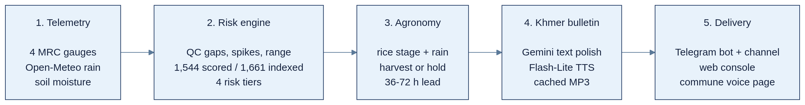

# Process flow diagram

**Flow:** 4 MRC gauges and Open-Meteo feed a QC and risk engine. The agronomic engine turns risk, rice stage, and rain into Khmer text and audio. Telegram, the web console, and commune pages deliver it. Field reports feed back into the evidence layer.

Officer approval gates every watch-run publish. The agentic layer runs beside this pipeline: the advisor and watch agent call tools and stop for approval.

Source: `diagrams/05-process-flow.mmd`. Paste into Mermaid Live to edit.

Visual: full-width flow, left to right. Put the approval note under the flow.
