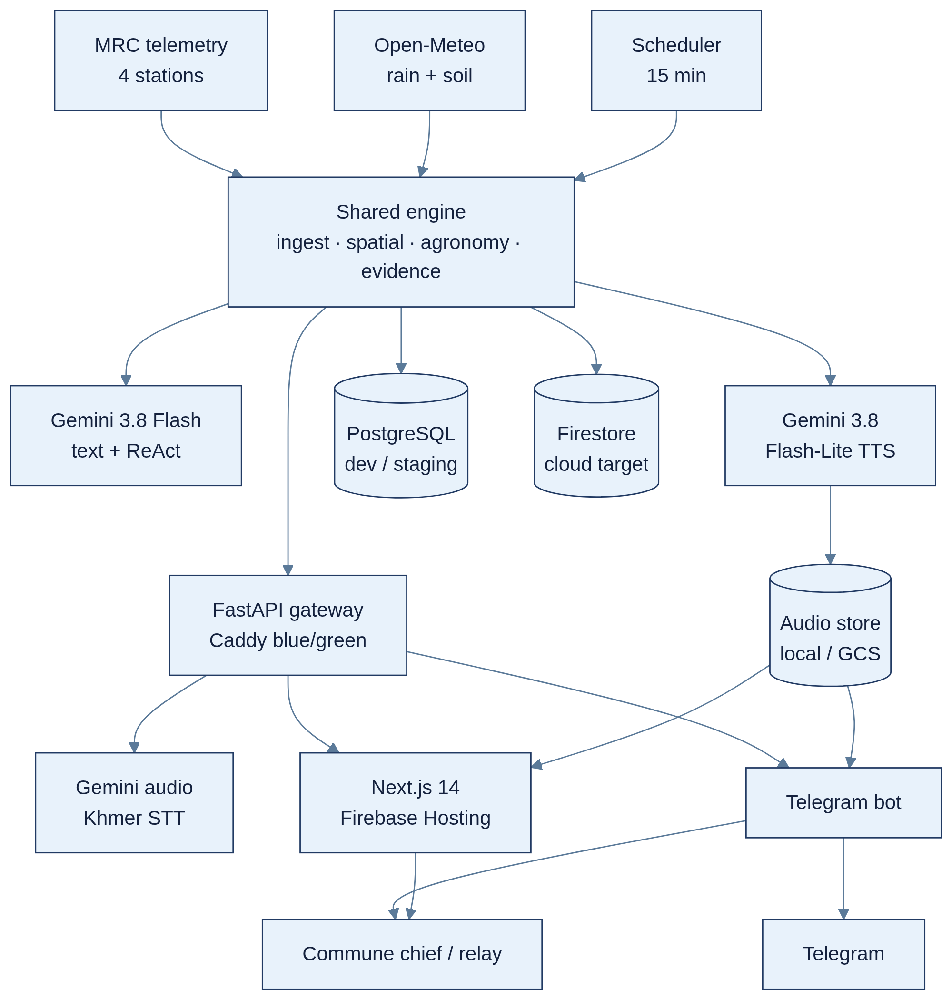

# Architecture diagram of the proposed solution

**Current demo:** Next.js static export on Firebase Hosting. FastAPI and PostgreSQL in Caddy blue/green containers on a self-hosted host with public HTTPS ingress. Audio on local disk.

**Cloud target:** Cloud Run, Firestore, Cloud Storage, Secret Manager, and Cloud Scheduler.

**Agentic layer:** the ReAct advisor and watch agent call tools for telemetry, evidence, crop directives, drafts, and publishing. Every call is traced. Publishing waits for an officer.

Source: `diagrams/07-architecture.mmd`. Paste into Mermaid Live to edit.

Visual: portrait architecture on the left, deployment notes on the right.
