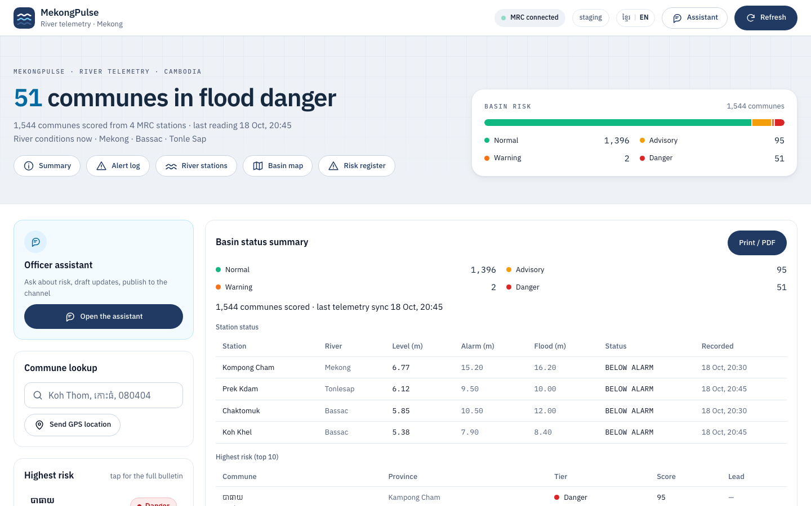
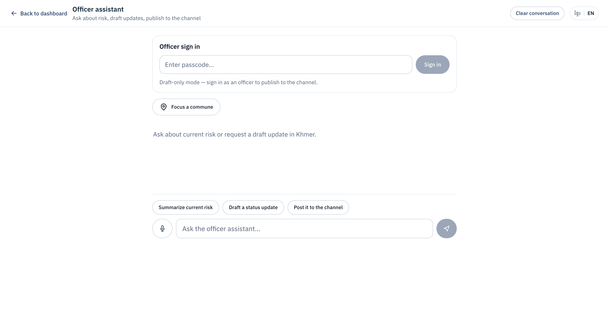
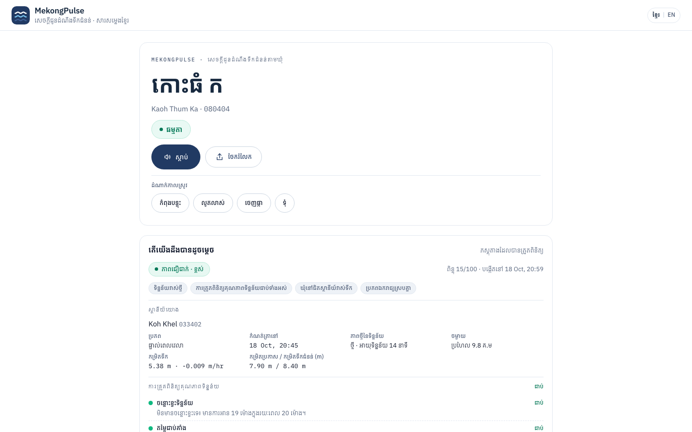

# Snapshots of the prototype

| Basin risk console                                | Officer assistant                                         | Khmer commune page                                        |
| ------------------------------------------------- | --------------------------------------------------------- | --------------------------------------------------------- |
|  |  |  |
| Risk tiers, station status, risk register         | Sign-in, Khmer voice input, draft and publish             | Voice player, stage chips, directives, evidence           |

**Live:** https://ai-builder-cup-9f8cd.web.app
**Bot:** @MekongPulseBot
**API:** https://mekongpulse-api.labyrinth.buzz
**Repo:** https://github.com/SunchhayK/mekongpulse

Prototype captured October 2026.

Visual: three screenshots across the slide, equal size, one caption line each.
