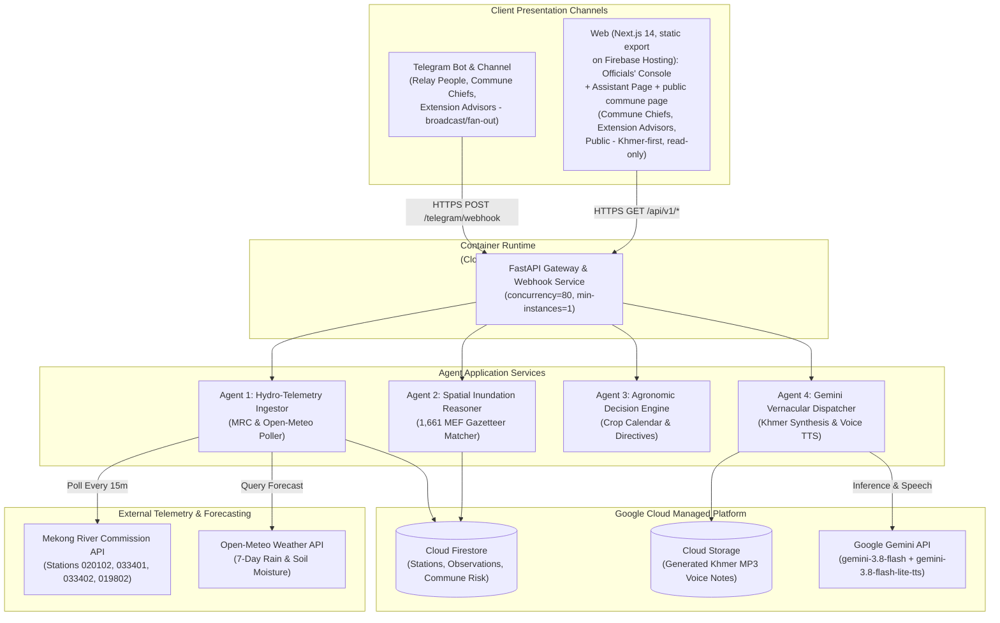
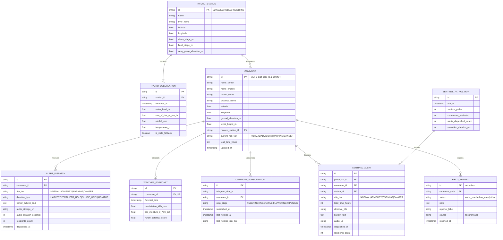

# Technical Report: MekongPulse

## 1. Technical Requirements Document (TRD)

### 1.1 Scope of engineering work

- **In-scope**:
  - Python 3.12 FastAPI microservice. Deployment-ready on Google Cloud Run in Singapore (`asia-southeast1`) via `deploy_gcp.sh`; the current public demo runs the same container image self-hosted via Docker Compose behind a Cloudflare tunnel, with the console on Firebase Hosting (see §9.1).
  - Google Cloud Agent Development Kit (ADK) multi-agent pipeline: Ingestion Agent, Spatial Reasoner, Agronomic Advisor, Khmer Vernacular Dispatcher.
  - Telemetry integration with Mekong River Commission (MRC) REST API (`api.mrcmekong.org`) for 4 permanent Cambodian stations: Prek Kdam (`020102`), Chaktomuk (`033401`), Koh Khel (`033402`), and Kompong Cham (`019802`).
  - Weather forecast integration with Open-Meteo API for 7-day hourly precipitation and 0–7cm soil moisture.
  - Spatial in-memory R-Tree index over the official 2025 MEF Cambodian administrative gazetteer (1,661 communes).
  - Gemini integration via the Gemini API: `gemini-3.8-flash` for Khmer bulletin polish and the ADK advisor; `gemini-3.8-flash-lite-tts` for spoken Khmer audio (24 kHz PCM WAV transcoded to MP3 with `lameenc`; no system ffmpeg in the container).
  - Telegram Bot webhook processing for GPS location pin queries and automated broadcast dispatches.
  - Rice-stage profiles: the bot asks once per commune subscription (Khmer inline options), stores the stage on the subscription, and reuses it for every alert and advisory answer. Escalations are dispatched per stage group, so each subscriber receives their stage's directive set; the public channel receives a single post per escalation (conservative ripening posture). `/crop` changes the stage later; the web console is read-only and never collects per-farmer data.
  - Deterministic verification layer (`shared/src/mekong_shared/evidence.py`): provenance, QC over the stored station series (gaps, stuck, spike, range), two heuristic cross-checks (rainfall agreement, upstream coherence), a confidence label with stable reason ids, a 5-step bilingual evidence chain, and the MRC-style limitations notice — no LLM in any verdict.
  - Ground-truth field reporting: `FieldReport` model + `field_reports` table (idempotent DDL), filed from the Telegram `/report` flow or `POST /api/v1/communes/{code}/reports` and listed for officials, the console, and the commune page.
  - Officer assistant with actions (`POST /api/v1/advisor`) on a dedicated page (`/{locale}/assistant`) and in Telegram: `get_commune_evidence`, `draft_status_update`, and `publish_to_channel` tools with tool-call tracing (`answer_detailed` → `AdvisorOutcome`); publishing is gated by an officer session issued by `POST /api/v1/officer/login` (passcode → HMAC-signed, 12 h token; the admin token never reaches the browser, while the legacy `X-Officer-Token` header remains for scripts). A deterministic bilingual daily digest (`shared/src/mekong_shared/digest.py`) posts via admin-guarded `POST /api/v1/digest/send` or the bot's `/digest`.
  - Assistant web surface: replies render as GFM markdown (`react-markdown` + `remark-gfm`; raw HTML disabled, external links open safely) at chat scale for Khmer; the thread and focused commune persist in `localStorage` (60-message cap) across refreshes. Admin `GET /api/v1/telegram/channel` verifies that the bot can see the configured broadcast channel, and publish/digest failures map Telegram errors to setup guidance.
  - Spoken Khmer assistant input: `POST /api/v1/advisor/transcribe` forwards a recorded clip (≤ 4 MB, ≤ 60 s) to `gemini-3.8-flash` audio understanding and returns text; provider or quota failures raise `TranscriptionUnavailable` → 503 problem, never a 500.
  - Model resilience: an ordered Gemini text chain (`GEMINI_TEXT_MODEL`, then `GEMINI_FALLBACK_MODELS`; default `gemini-3.7-flash,gemini-3.6-flash,gemini-3.5-flash-lite`) rotates inside the model-call layer — an ADK `BaseLlm` wrapper for the primary engine and the same loop in the native ReAct caller; STT uses the chain too. Quota (429), overload (503), and missing-model (404) failures cool down per model (1 h / 60 s / 6 h) without replaying a turn. Gemma 4 was evaluated and rejected: `gemma-4-26b-a4b-it` emits tool calls but leaks reasoning and ignores language instructions in final answers, and `gemma-4-31b-it` fails with tools.
  - Bilingual Khmer-first web: next-intl `[locale]` routing (`km` default, `en` toggle) with static export (`trailingSlash`; Firebase `/` → `/km/index.html`), the dedicated officer assistant page at `/{locale}/assistant`, the public commune page at `/{locale}/commune?code=XXXXXX`, and `WEB_BASE_URL` driving the commune links appended to channel posts.
  - Firestore for time-series observation snapshots, commune risk profiles, and alert history in production; PostgreSQL (asyncpg) in development, staging, and self-hosted modes; Cloud Storage for audio caching. Spoken bulletins are content-addressed from the deterministic briefing inputs — river level bucketed to 0.1 m, 48-hour rain to 5 mm, and the bulletin's fast/slow/stable rate wording — so repeated and shared commune views reuse one MP3 across 15-minute telemetry ticks. The commune page keeps the chosen crop stage in `?stage=`, so a shared link reproduces the same briefing.
  - Sync cost discipline: the 15-minute trigger calls `/patrol/run` only (patrol performs the sync itself), weather is refreshed hourly, unchanged commune-risk rows are not rewritten, and polished Khmer bulletins are cached by template digest. Reproducible measurements and scripts live in `projects/BENCHMARKS.md` and `projects/scripts/benchmark_*.py`.
  - Vertex AI mode: `USE_VERTEX_AI=true` routes bulletin polish, TTS, STT, and the advisor through Vertex AI (`VERTEX_PROJECT=ai-builder-cup-9f8cd`, `VERTEX_LOCATION=global`) using a read-only service-account key mounted at `/secrets/vertex-sa.json` (`docker-compose.vertex.yml`; the key lives outside the repository with mode 600). ADK's `GoogleLLM` stalls against Vertex in the current SDK, so `ADVISOR_USE_ADK=false` selects the equivalent native ReAct loop; ADK remains the default for Gemini API keys.
  - Watch-officer runs: `POST /api/v1/watch/runs` builds a pending approval task (evidence, agent rationale, tool trace, deterministic bilingual draft) for a specified commune or the highest-risk commune. The officer inbox lists runs, edits the draft, approves (publishing through the channel publisher), or rejects; patrol queues up to `WATCH_AUTO_MAX_RUNS` runs for upward WARNING/DANGER transitions. Telegram `/watch` with no argument lists the five highest-risk communes as one-tap buttons (with refresh), registers a command menu at startup, and offers inline approval for IDs in `OFFICER_TELEGRAM_IDS`. Nothing publishes without an officer.
- **Deferred / out-of-scope**:
  - Custom physical river buoys or ultrasonic sensor hardware.
  - Heavy 2D hydrodynamic numerical fluid simulations.
  - SMS cellular telecommunication gateways.
  - Native mobile application binaries (iOS/Android app store packages).

### 1.2 Technology stack and tooling inventory

| Category                     | Technology / Library / SDK         | Pinned version    | Purpose in project                                                 |
| ---------------------------- | ---------------------------------- | ----------------- | ------------------------------------------------------------------ |
| Runtime & Language           | Python, CPython                    | 3.11-slim         | Core microservice execution and async runtime                      |
| Package & Tool Manager       | uv                                 | >= 0.5.0          | Sub-second deterministic dependency resolution and virtualenv sync |
| Web Framework                | FastAPI                            | 0.115.x           | High-throughput asynchronous HTTP API and webhook gateway          |
| ASGI Web Server              | Uvicorn (standard)                 | 0.32.x            | Production HTTP/1.1 server worker                                  |
| Schema & Settings Validation | Pydantic, pydantic-settings        | 2.10.x            | Request/response data validation and type enforcement              |
| Async HTTP Client            | HTTPX                              | 0.28.x            | Non-blocking telemetry ingestion client with connection pooling    |
| Spatial & Geometry Engine    | Shapely, Rtree / STRtree           | 2.0.x             | Sub-15ms in-memory spatial geocoding for 1,661 MEF communes        |
| AI Reasoning & Synthesis     | google-genai (Gemini API), google-adk (bot) | 1.x / 2.12.x      | `gemini-3.8-flash` bulletins & ADK advisor; `gemini-3.8-flash-lite-tts` Khmer voice synthesis |
| Time-Series & State Store    | google-cloud-firestore             | 2.19.x            | Real-time observation snapshots and commune risk index             |
| Audio Object Storage         | google-cloud-storage               | 2.18.x            | Direct streaming upload and hosting for synthesized MP3 notes      |
| Secret Management            | google-cloud-secret-manager        | 2.20.x            | Zero-leak credential injection for Telegram and Gemini keys        |
| Task Scheduling              | Google Cloud Scheduler             | Managed           | Scheduled 15-minute HTTP cron triggers to `/api/v1/patrol/run` (which runs the telemetry sync first); when self-hosted, host cron mirrors it (`server_sync.sh`) and posts the daily digest (`server_digest.sh`, 07:00 Asia/Phnom_Penh) |
| Serverless Hosting           | Google Cloud Run + Firebase Hosting | Gen 2 (Singapore) | Auto-scaling API containers (`asia-southeast1`) + static dashboard on Firebase Hosting |
| Basin Map & Charts           | Leaflet, HTML5 canvas hydrographs | 1.9.x | Interactive commune risk map with switchable Esri Light Gray, OpenStreetMap and OpenTopoMap basemaps; no API key; overlays render over a neutral canvas when tiles are slow |
| UI Framework                 | React 18 + hand-rolled CSS design tokens | 18.3.x      | Light "river lab" theme (navy `#213a63`, sky `#0ea5e9`), IBM Plex + Kantumruy Pro fonts; no external UI library |
| Web i18n                     | next-intl                          | 3.26.5            | Khmer-first locale routing (`/km` default, `/en` toggle) across the console, the officer assistant page, and the public commune page |
| Design Tokens & UI Contract  | CSS custom properties + root `DESIGN.md` | v1.0         | Tokenized palette, type scale, and component states consumed across the console |
| Test Harness                 | Pytest, pytest-asyncio, pytest-cov | 8.3.x             | Deterministic unit and Given-When-Then integration tests           |

### 1.3 High-risk domains: Buy vs build policy

| High-risk domain                        | Why building from scratch fails                                                                                            | Standard vetted solution in MekongPulse                                                     |
| --------------------------------------- | -------------------------------------------------------------------------------------------------------------------------- | ------------------------------------------------------------------------------------------- |
| **Secret management & API keys**        | Hardcoded env files in Git repositories leak API tokens; container layer leaks expose credentials in image registries.     | Google Cloud Secret Manager injected via Cloud Run runtime metadata (`--set-secrets`).      |
| **Object storage & audio delivery**     | Buffering multi-megabyte synthesized audio streams in memory crashes lightweight Cloud Run instances with OOM errors.      | Direct stream pipe to Google Cloud Storage (`google-cloud-storage`) with public CDN URLs.   |
| **Spoken Khmer speech synthesis**       | Hand-rolled phoneme synthesizers or rule-based TTS lack Khmer tone sandhi, honorifics, and dialect nuances.                | Google Gemini native TTS (`gemini-3.8-flash-lite-tts`, cheaper and lower-latency than Flash TTS) with Khmer prompting; 24 kHz PCM transcoded to MP3 with `lameenc`. |
| **Spatial point-in-polygon resolution** | Iterating 1,661 commune polygon boundaries sequentially yields O(N) lookup times exceeding 450ms.                          | In-memory Shapely STRtree index over 2025 MEF gazetteer GeoJSON yielding < 15ms lookups.    |
| **Scheduled telemetry synchronization** | In-process `while True: await asyncio.sleep(900)` loops crash silently on unhandled exceptions and fail across instances. | Google Cloud Scheduler firing authenticated HTTP POST triggers to `/api/v1/patrol/run` (the patrol performs the sync before alert evaluation). |
| **Webhook authentication**              | Blindly processing incoming webhooks leaves bots open to spoofed payload injection and replay attacks.                     | HMAC token verification via standard `X-Telegram-Bot-Api-Secret-Token` header validation.   |

### 1.4 SLA / SLO performance budgets

| Metric                                       | Target objective (SLO) | Degradation threshold (alert) | Measurement tool                       |
| -------------------------------------------- | ---------------------- | ----------------------------- | -------------------------------------- |
| Telegram Location Webhook Latency (p95)      | < 3,000ms              | > 5,000ms for 5 mins          | Cloud Run Request Latency Metric       |
| Telemetry Polling Execution (All 4 stations) | < 4,000ms              | > 10,000ms                    | Ingestion Worker Timer Metric          |
| Spoken Khmer Audio Synthesis Time            | < 2,200ms              | > 4,500ms                     | Gemini client span tracing             |
| Memory Footprint (per instance)              | < 600MB steady-state   | > 1.4GB (OOM warning)         | Cloud Run Container Memory Utilization |
| Spatial Gazette Geocoding Query              | < 15ms                 | > 50ms                        | In-Memory Shapely R-Tree Lookup Timer  |
| Cold-Start Response Time                     | < 1,500ms              | > 3,500ms                     | Cloud Monitoring Startup Latency       |

### 1.5 Security and authentication architecture

- **API and Webhook Security**: Telegram incoming updates enforce the `X-Telegram-Bot-Api-Secret-Token` header. Web dashboard REST APIs enforce CORS restricted to verified domains (`*.run.app` and localhost during development).
- **Secret Management**: Google Cloud Secret Manager manages credentials (`TELEGRAM_BOT_TOKEN`, `GEMINI_API_KEY`, `GCS_BUCKET_NAME`) in the Cloud Run path; development, staging, and self-hosted modes read the same names from the gitignored `.env` presets.
- **Data Protection**: User GPS coordinates and subscriber identifiers are anonymized via SHA-256 salting before persistent logging in Firestore. TLS 1.3 encryption is enforced in transit.
- **Access Control**: Public endpoints allow read-only telemetry queries; administrative broadcast triggers require IAM Bearer token authentication.
- **Officer Sign-In and Sessions**: `POST /api/v1/officer/login` compares the submitted passcode (`OFFICER_PASSCODE`, falling back to `ADMIN_TOKEN`) in constant time and issues an HMAC-SHA256-signed, expiring session (`v1.<exp>.<sig>`, TTL `OFFICER_SESSION_TTL_HOURS`, default 12 h); five failed attempts per IP per minute return 429. The advisor authorizes publishing from `Authorization: Bearer <session>` or, for scripts, the legacy `X-Officer-Token` admin header; the digest trigger remains admin-guarded like `/telemetry/sync`.
- **Voice Input Boundary**: the transcribe endpoint accepts up to 4 MB of audio, forwards it to Gemini for transcription, and never persists the clip; provider failures degrade to a 503 problem.

### 1.6 Observability and telemetry

- **Structured JSON Logging**: Standard Python logging emits JSON structured lines:
  ```json
  {
    "timestamp": "2026-10-16T02:00:00Z",
    "level": "INFO",
    "trace_id": "projects/bytelab/traces/8f1e2d3c",
    "event": "TELEGRAM_LOCATION_QUERY",
    "commune_code": "080404",
    "commune_name": "Kaoh Thum Ka",
    "risk_tier": "WARNING",
    "audio_generated": true,
    "duration_ms": 2420
  }
  ```
- **OpenTelemetry Tracing**: W3C `traceparent` context propagated across Cloud Run instances, background workers, and Gemini API calls.
- **Verification and Officer Events**: structured events cover the new surfaces — `EVIDENCE_BUILT` (commune, tier, confidence), `FIELD_REPORT_ADDED`, `ADVISOR_ANSWERED` (tool-call count, authorization), and `DIGEST_SENT` / `DIGEST_SEND_FAILED`.
- **Health Verification**: Exposes `/health` returning status `HEALTHY`, MRC station connectivity check, and Firestore connection state.

---

## 2. Software Design Document (SDD)

### 2.1 C4 container architecture



### 2.2 Dependency boundaries and directory layout

- **Inward dependency rule**: `Domain` core has zero external framework dependencies. `Application` imports `Domain`. `Infrastructure` and `Presentation` import `Application` and `Domain`.
- **Directory layout** (uv workspace under `projects/`):
  ```text
  projects/
  ├── shared/src/mekong_shared/    # Domain engine: models, MRC + Open-Meteo clients, SpatialRiskClassifier,
  │                                # AgriDecisionEngine, MekongSentinel, TTS, evidence layer, digest,
  │                                # advisor tools, repositories (memory/Postgres/Firestore)
  ├── backend/src/mekong_backend/  # FastAPI gateway: routers/ (telemetry, communes + evidence + reports,
  │                                # advisor + digest, ...), deps.py, problems.py, app.py, main.py
  ├── bot/src/mekong_bot/          # Telegram service, dispatcher, PTB handlers (/report, /digest), polling entrypoint
  ├── frontend/src/app/[locale]/   # Next.js 14 console (km default) + assistant page + commune page, static export
  └── scripts/                     # switch_env.sh, run_dev.sh, init_db.sh, server_sync.sh, server_digest.sh, deploy_gcp.sh, build_gazetteer.py
  ```

### 2.3 Failure modes and resilience

- **Adjacent station failover**: If Prek Kdam (`020102`) times out or returns HTTP 500, the ingestion service automatically falls back to Chaktomuk (`033401`) — or Koh Khel (`033402`) when Chaktomuk is also unavailable — applying an empirically derived hydraulic offset (median stage difference over the overlapping historical window, recomputed on every refresh; see `compute_hydraulic_offset`).
- **Gemini audio synthesis timeout**: The Telegram webhook never blocks on audio: location/share replies are text-only risk cards, and voice notes are attached only on the alert push path, so the webhook always responds within Telegram's deadline. When synthesis is unavailable, alerts degrade to text (audio is best-effort; text is always delivered); TTS quota exhaustion (`TTSUnavailable`) follows the same path, including the commune page's text fallback.
- **Cold cache resilience**: The spatial gazetteer is bundled in the container image (`data/commune_gazetteer_2025.json`, ~0.8 MB centroids + DEM elevations, plus `data/raw/mef_commune_boundaries.geojson`, ~6.3 MB polygons), requiring zero external network calls during cold start.

---

## 3. Entity Relationship Diagrams (ERD) & Schema

### 3.1 Relational schema



### 3.2 Indexing strategy and partition keys

- `idx_observations_station_time`: Firestore composite index on `(station_id ASC, recorded_at DESC)` for 7-day hydrograph queries.
- `idx_communes_risk_province`: Firestore composite index on `(current_risk_tier ASC, province_name ASC)` for regional flood map filtering.
- `idx_alerts_commune_time`: Firestore composite index on `(commune_id ASC, dispatched_at DESC)` for alert deduplication and auditing.
- `idx_field_reports_commune_time`: PostgreSQL index on `field_reports(commune_code, reported_at DESC)` for the per-commune report list. All `field_reports` DDL is `CREATE ... IF NOT EXISTS` and appended to the idempotent init script, so it is backward-compatible for the color still serving during a blue-green switch.
- `spatial_rtree_communes`: In-memory R-Tree spatial index mapping latitude/longitude coordinates to MEF commune boundaries in <15ms.

---

## 4. API Specifications

### 4.1 OpenAPI 3.1 definitions

```yaml
openapi: 3.1.0
info:
  title: MekongPulse REST API
  description: OpenAPI 3.1.0 Specification for MekongPulse Autonomous Hydrological Telemetry & Agronomic Preservation Platform.
  version: 1.0.0
servers:
  - url: https://mekongpulse-backend-<hash>-as.a.run.app  # from `gcloud run services describe`; see §9.1
    description: Production Google Cloud Run (Singapore)
  - url: http://localhost:8080
    description: Local Development Environment

paths:
  /api/v1/health:
    get:
      summary: Liveness and Readiness Probe
      operationId: checkHealth
      responses:
        "200":
          description: Service is healthy.
          content:
            application/json:
              schema:
                type: object
                properties:
                  status:
                    type: string
                    example: "HEALTHY"
                  timestamp:
                    type: string
                    format: date-time
                  mrc_station_connection:
                    type: string
                    example: "CONNECTED"

  /api/v1/telemetry/latest:
    get:
      summary: Get latest cached telemetry across all monitored Mekong stations
      operationId: getLatestTelemetry
      responses:
        "200":
          description: Array of latest station readings.
          content:
            application/json:
              schema:
                type: array
                items:
                  $ref: "#/components/schemas/StationTelemetry"

  /api/v1/communes/risk-map:
    get:
      summary: Retrieve real-time inundation risk ratings for Cambodian communes
      operationId: getCommuneRiskMap
      parameters:
        - name: province
          in: query
          required: false
          schema:
            type: string
          example: "Kandal"
      responses:
        "200":
          description: List of commune risk profiles for map visualization.
          content:
            application/json:
              schema:
                type: array
                items:
                  $ref: "#/components/schemas/CommuneRiskProfile"

  /api/v1/communes/{commune_code}/assess:
    post:
      summary: Trigger on-demand hydrological & agronomic risk assessment
      operationId: assessCommuneRisk
      parameters:
        - name: commune_code
          in: path
          required: true
          schema:
            type: string
          example: "080404"
      requestBody:
        required: false
        content:
          application/json:
            schema:
              type: object
              properties:
                crop_stage:
                  type: string
                  description: >-
                    Rice stage for directive selection. Optional; defaults to RIPENING.
                    In production the value comes from the farmer's stored subscription
                    profile (set once in the Telegram bot); the read-only web console
                    never sends it.
                  enum: [TILLERING, VEGETATIVE, FLOWERING, RIPENING]
                  default: RIPENING
      responses:
        "200":
          description: Localized risk assessment and agronomic action directives.
          content:
            application/json:
              schema:
                $ref: "#/components/schemas/AssessmentResult"
        "404":
          $ref: "#/components/responses/NotFound"

  /api/v1/alerts/log:
    get:
      summary: List dispatched sentinel alerts, newest first
      operationId: getAlertLog
      parameters:
        - name: limit
          in: query
          required: false
          schema:
            type: integer
            minimum: 1
            maximum: 200
            default: 50
      responses:
        "200":
          description: Newest-first dispatched escalation records with gazetteer-enriched commune names.
          content:
            application/json:
              schema:
                type: array
                items:
                  type: object
                  properties:
                    id:
                      type: integer
                      nullable: true
                    commune_code:
                      type: string
                    commune_name_kh:
                      type: string
                    commune_name_en:
                      type: string
                    province:
                      type: string
                      nullable: true
                    station_id:
                      type: string
                      nullable: true
                    risk_tier:
                      type: string
                      enum: [NORMAL, ADVISORY, WARNING, DANGER]
                    lead_time_hours:
                      type: integer
                      nullable: true
                    directive_title:
                      type: string
                    bulletin_text:
                      type: string
                    audio_url:
                      type: string
                      nullable: true
                    dispatched_at:
                      type: string
                      format: date-time
                    recipients_count:
                      type: integer

  /api/v1/communes/{commune_code}/evidence:
    get:
      summary: Deterministic evidence pack behind a commune's risk row
      operationId: getCommuneEvidence
      parameters:
        - name: commune_code
          in: path
          required: true
          schema:
            type: string
          example: "080404"
      responses:
        "200":
          description: Provenance payload — freshness, QC, cross-checks, confidence, evidence chain, limitations. No LLM, no audio.
          content:
            application/json:
              schema:
                $ref: "#/components/schemas/EvidencePayload"
        "404":
          $ref: "#/components/responses/NotFound"
        "409":
          description: Commune has no station assignment or the station is not configured.

  /api/v1/communes/{commune_code}/reports:
    post:
      summary: File a ground-truth field report for a commune
      operationId: createFieldReport
      parameters:
        - name: commune_code
          in: path
          required: true
          schema:
            type: string
      requestBody:
        required: true
        content:
          application/json:
            schema:
              type: object
              required: [status]
              properties:
                status:
                  type: string
                  enum: [water_reached, no_water, other]
                note:
                  type: string
                  nullable: true
                reporter_label:
                  type: string
                  nullable: true
      responses:
        "201":
          description: Stored report (source "web"; the Telegram /report flow stores source "telegram").
          content:
            application/json:
              schema:
                $ref: "#/components/schemas/FieldReport"
        "404":
          $ref: "#/components/responses/NotFound"
    get:
      summary: List a commune's field reports, newest first
      operationId: listFieldReports
      parameters:
        - name: commune_code
          in: path
          required: true
          schema:
            type: string
        - name: limit
          in: query
          required: false
          schema:
            type: integer
            minimum: 1
            maximum: 100
            default: 20
      responses:
        "200":
          description: Field reports for the commune.
          content:
            application/json:
              schema:
                $ref: "#/components/schemas/FieldReportList"

  /api/v1/officer/login:
    post:
      summary: Exchange the officer passcode for a short-lived signed session
      operationId: officerLogin
      requestBody:
        required: true
        content:
          application/json:
            schema:
              type: object
              required: [passcode]
              properties:
                passcode:
                  type: string
      responses:
        "200":
          description: Signed session and expiry.
          content:
            application/json:
              schema:
                type: object
                required: [session, expires_at]
                properties:
                  session:
                    type: string
                  expires_at:
                    type: string
                    format: date-time
        "401":
          description: Invalid passcode.
        "429":
          description: Too many failed attempts; retry later.
        "503":
          description: Officer sign-in is not configured.

  /api/v1/advisor/transcribe:
    post:
      summary: Transcribe a recorded voice clip to text (server-side Khmer ASR)
      operationId: advisorTranscribe
      requestBody:
        required: true
        content:
          application/json:
            schema:
              type: object
              required: [audio_base64, mime_type]
              properties:
                audio_base64:
                  type: string
                  maxLength: 6000000
                mime_type:
                  type: string
                locale_hint:
                  type: string
                  enum: [km, en]
                  nullable: true
      responses:
        "200":
          description: Transcript.
          content:
            application/json:
              schema:
                type: object
                properties:
                  text:
                    type: string
        "413":
          description: Audio exceeds 4 MB.
        "503":
          description: Transcription unavailable.

  /api/v1/advisor:
    post:
      summary: One traced officer-assistant turn (draft then officer-gated publish)
      operationId: advisorTurn
      parameters:
        - name: Authorization
          in: header
          required: false
          schema:
            type: string
          description: Bearer officer session from /api/v1/officer/login; enables the publish_to_channel action.
        - name: X-Officer-Token
          in: header
          required: false
          schema:
            type: string
          description: Legacy/script officer token (the admin token); still accepted for publishing.
      requestBody:
        required: true
        content:
          application/json:
            schema:
              type: object
              required: [message]
              properties:
                message:
                  type: string
                  maxLength: 2000
                history:
                  type: array
                  maxItems: 6
                  items:
                    type: object
                    required: [role, content]
                    properties:
                      role:
                        type: string
                        enum: [user, assistant]
                      content:
                        type: string
                        maxLength: 4000
                locale:
                  type: string
                  enum: [km, en]
                  default: km
                commune_code:
                  type: string
                  nullable: true
      responses:
        "200":
          description: Traced reply with tool calls and action results.
          content:
            application/json:
              schema:
                $ref: "#/components/schemas/AdvisorReply"
        "503":
          description: Advisor unavailable (no Gemini key configured).

  /api/v1/watch/runs:
    get:
      summary: List watch-officer runs (officer session required)
      operationId: listWatchRuns
      parameters:
        - name: Authorization
          in: header
          required: true
          schema:
            type: string
        - name: status
          in: query
          required: false
          schema:
            type: string
            enum: [pending_approval, published, rejected, failed]
        - name: limit
          in: query
          required: false
          schema:
            type: integer
            default: 20
      responses:
        "200":
          description: Recent watch runs, newest first.
        "401":
          description: Officer session required.
    post:
      summary: Create a watch run (draft + approval task, never publishes)
      operationId: createWatchRun
      parameters:
        - name: Authorization
          in: header
          required: true
          schema:
            type: string
      requestBody:
        required: false
        content:
          application/json:
            schema:
              type: object
              properties:
                commune_code:
                  type: string
                  nullable: true
      responses:
        "200":
          description: Pending approval run with draft, rationale, and tool trace.
        "401":
          description: Officer session required.
        "409":
          description: Commune has no current risk row.

  /api/v1/watch/runs/{run_id}/approve:
    post:
      summary: Approve a watch run and publish its bilingual draft
      operationId: approveWatchRun
      parameters:
        - name: Authorization
          in: header
          required: true
          schema:
            type: string
        - name: run_id
          in: path
          required: true
          schema:
            type: string
      requestBody:
        required: false
        content:
          application/json:
            schema:
              type: object
              properties:
                khmer_text:
                  type: string
                  maxLength: 3500
                english_text:
                  type: string
                  maxLength: 3500
      responses:
        "200":
          description: Published run with Telegram message id.
        "409":
          description: Run is already published or rejected.
        "502":
          description: Telegram rejected the post (actionable detail).
        "503":
          description: Telegram channel is not configured.

  /api/v1/watch/runs/{run_id}/reject:
    post:
      summary: Reject a watch run without publishing
      operationId: rejectWatchRun
      parameters:
        - name: Authorization
          in: header
          required: true
          schema:
            type: string
        - name: run_id
          in: path
          required: true
          schema:
            type: string
      responses:
        "200":
          description: Rejected run.
        "409":
          description: Run is already published or rejected.

  /api/v1/digest/send:
    post:
      summary: Build and post the bilingual daily digest to the public channel
      operationId: sendDigest
      responses:
        "200":
          description: posted | unavailable (no Telegram config) | error (post failed) — cron-friendly, never a 5xx for a missing channel.
          content:
            application/json:
              schema:
                $ref: "#/components/schemas/DigestSendResult"

  /api/v1/telegram/channel:
    get:
      summary: Admin diagnostic for the configured broadcast channel
      operationId: checkTelegramChannel
      responses:
        "200":
          description: ok true with id/type/title/username, or ok false with actionable detail.
          content:
            application/json:
              schema:
                type: object
                required: [configured_id, ok]
                properties:
                  configured_id:
                    type: string
                  ok:
                    type: boolean
                  id:
                    type: integer
                  type:
                    type: string
                  title:
                    type: string
                  username:
                    type: string
                  detail:
                    type: string
        "503":
          description: Telegram bot token or channel id is not configured.

  /api/v1/telegram/webhook:
    post:
      summary: Telegram Bot Webhook Endpoint
      operationId: handleTelegramUpdate
      parameters:
        - name: X-Telegram-Bot-Api-Secret-Token
          in: header
          required: true
          schema:
            type: string
      requestBody:
        required: true
        content:
          application/json:
            schema:
              type: object
      responses:
        "200":
          description: Update processed successfully.

components:
  schemas:
    StationTelemetry:
      type: object
      required:
        [
          station_id,
          station_name,
          water_level_m,
          rate_of_rise_m_per_hr,
          alarm_stage_m,
          recorded_at,
        ]
      properties:
        station_id:
          type: string
          example: "033402"
        station_name:
          type: string
          example: "Koh Khel"
        river_name:
          type: string
          example: "Bassac River"
        water_level_m:
          type: number
          format: float
          example: 7.62
        rate_of_rise_m_per_hr:
          type: number
          format: float
          example: 0.07
        alarm_stage_m:
          type: number
          format: float
          example: 7.50
        flood_stage_m:
          type: number
          format: float
          example: 7.90
        recorded_at:
          type: string
          format: date-time

    CommuneRiskProfile:
      type: object
      required:
        [
          commune_code,
          commune_name_khmer,
          commune_name_english,
          risk_tier,
          lead_time_hours,
        ]
      properties:
        commune_code:
          type: string
          example: "080404"
        commune_name_khmer:
          type: string
          example: "កោះធំ ក"
        commune_name_english:
          type: string
          example: "Kaoh Thum Ka"
        province:
          type: string
          example: "Kandal"
        risk_tier:
          type: string
          enum: [NORMAL, ADVISORY, WARNING, DANGER]
          example: "WARNING"
        lead_time_hours:
          type: integer
          example: 38

    AssessmentResult:
      type: object
      required: [commune_code, risk_tier, directive, khmer_bulletin]
      properties:
        commune_code:
          type: string
          example: "080404"
        risk_tier:
          type: string
          enum: [NORMAL, ADVISORY, WARNING, DANGER]
        lead_time_hours:
          type: integer
          example: 38
        directive:
          type: string
          example: "EMERGENCY_HARVEST_ACCELERATION"
        khmer_bulletin:
          type: string
        audio_url:
          type: string
          format: uri
          nullable: true

    ProblemDetails:
      type: object
      required: [type, title, status, detail]
      properties:
        type:
          type: string
          format: uri
        title:
          type: string
        status:
          type: integer
        detail:
          type: string
        instance:
          type: string

    EvidencePayload:
      type: object
      required: [commune_code, generated_at, risk_tier, confidence, station, qc, evidence_chain, limitations]
      properties:
        commune_code:
          type: string
          example: "080404"
        commune_name_kh:
          type: string
        commune_name_en:
          type: string
        generated_at:
          type: string
          format: date-time
        risk_tier:
          type: string
          enum: [NORMAL, ADVISORY, WARNING, DANGER]
        score:
          type: integer
        confidence:
          type: string
          enum: [high, medium, low]
        confidence_reasons:
          type: array
          description: Stable reason ids (fresh_telemetry, stale_telemetry, qc_clean, qc_warning, qc_fail, near_station, far_from_station, sources_agree, source_disagree).
          items:
            type: string
        station:
          type: object
          properties:
            station_id:
              type: string
            name:
              type: string
            distance_km:
              type: number
              nullable: true
            source:
              type: string
              enum: [live, fallback, cache]
            recorded_at:
              type: string
              format: date-time
            age_minutes:
              type: integer
            freshness:
              type: string
              enum: [fresh, recent, stale]
            level_m:
              type: number
            rate_of_rise_m_per_hr:
              type: number
            alarm_stage_m:
              type: number
            flood_stage_m:
              type: number
        qc:
          type: object
          properties:
            status:
              type: string
              enum: [pass, warn, fail, unavailable]
            checks:
              type: array
              items:
                type: object
                properties:
                  id:
                    type: string
                    enum: [gaps, stuck, spike, range]
                  status:
                    type: string
                    enum: [pass, warn, fail, unavailable]
                  detail:
                    type: string
                  detail_kh:
                    type: string
        cross_checks:
          type: array
          items:
            type: object
            properties:
              id:
                type: string
                enum: [rainfall_agreement, upstream_coherence]
              status:
                type: string
                enum: [agree, disagree, unavailable]
              detail:
                type: string
              detail_kh:
                type: string
        evidence_chain:
          type: array
          description: Five bilingual steps — reading, change, threshold, tier, directive.
          items:
            type: object
            properties:
              id:
                type: string
                enum: [reading, change, threshold, tier, directive]
              text_en:
                type: string
              text_kh:
                type: string
        limitations:
          type: object
          properties:
            text_en:
              type: string
            text_kh:
              type: string

    FieldReport:
      type: object
      required: [id, commune_code, status, source, reported_at]
      properties:
        id:
          type: string
        commune_code:
          type: string
        status:
          type: string
          enum: [water_reached, no_water, other]
        note:
          type: string
          nullable: true
        reporter_label:
          type: string
          nullable: true
        source:
          type: string
          enum: [telegram, web]
        reported_at:
          type: string
          format: date-time

    FieldReportList:
      type: object
      properties:
        reports:
          type: array
          items:
            $ref: "#/components/schemas/FieldReport"

    AdvisorReply:
      type: object
      required: [reply, tool_calls, actions]
      properties:
        reply:
          type: string
        tool_calls:
          type: array
          items:
            type: object
            properties:
              name:
                type: string
              status:
                type: string
              summary:
                type: string
        actions:
          type: array
          description: Results of act tools — telegram_post with status posted | denied | unavailable | error.
          items:
            type: object
            properties:
              type:
                type: string
              status:
                type: string
              detail:
                type: string
                nullable: true

    DigestSendResult:
      type: object
      properties:
        status:
          type: string
          enum: [posted, unavailable, error]
        detail:
          type: string
          nullable: true
        digest_preview:
          type: string

  responses:
    NotFound:
      description: The requested resource was not found.
      content:
        application/problem+json:
          schema:
            $ref: "#/components/schemas/ProblemDetails"
```

---

## 5. Test Plans and Test Cases

Current suites, all green: 155 shared, 87 backend, 44 bot tests; the frontend typecheck and static export are clean. New coverage lands in `shared/tests/test_evidence.py`, `shared/tests/test_stt.py`, `shared/tests/test_model_rotation.py`, `shared/tests/test_adk_rotation.py`, `shared/tests/test_sync_cost.py`, `shared/tests/test_watch.py`, `backend/tests/test_evidence_api.py`, `backend/tests/test_reports_api.py`, `backend/tests/test_advisor_api.py`, `backend/tests/test_officer_auth.py`, `backend/tests/test_officer_login_api.py`, `backend/tests/test_officer_channel_api.py`, `backend/tests/test_watch_api.py`, `backend/tests/test_transcribe_api.py`, `backend/tests/test_digest_api.py`, `bot/tests/test_watch.py`, and the extended `bot/tests/test_service.py`.

### 5.1 Deterministic test matrix

| Test ID       | Module / Unit          | Given                               | When                        | Then                                                 | Priority |
| ------------- | ---------------------- | ----------------------------------- | --------------------------- | ---------------------------------------------------- | -------- |
| `TEST-HYD-01` | `MRCTelemetryClient`   | Station `020102` online             | `poll_station("020102")`    | Returns valid float water level and timestamp        | P0       |
| `TEST-HYD-02` | `MRCTelemetryClient`   | Station `020102` returns HTTP 500   | `poll_station("020102")`    | Fails over to `033401` with `is_stale_fallback=True` | P0       |
| `TEST-SPA-01` | `SpatialReasoner`      | GPS `(11.266, 105.033)` (Kandal; 2025 MEF boundary) | `resolve_commune(lat, lng)` | Returns commune `081001` (Khpob, S'ang) via polygon resolution; < 15ms typical | P0 |
| `TEST-SPA-02` | `SpatialReasoner`      | GPS `(14.058, 108.277)` in Vietnam  | `resolve_commune(lat, lng)` | Raises `OutsideBasinError` with 422 ProblemDetails   | P1       |
| `TEST-SPA-03` | `Gazetteer.search`     | Query "Koh Thom" (2025 MEF spelling "Kaoh Thum") | `search_commune(name)` | Returns `080404`/`080405` (Kaoh Thum Ka/Kha), all in district "Kaoh Thum" | P1 |
| `TEST-AGR-01` | `AgriDecisionEngine`   | Risk `WARNING`, Crop `RIPENING`     | `evaluate_directives()`     | Returns `EMERGENCY_HARVEST_ACCELERATION`             | P0       |
| `TEST-AGR-02` | `AgriDecisionEngine`   | Rain `> 50mm`, Crop `VEGETATIVE`    | `evaluate_directives()`     | Returns `HOLD_CHEMICAL_FERTILIZER`                   | P0       |
| `TEST-DIS-01` | `VernacularDispatcher` | Valid directive parameters          | `synthesize_khmer_voice()`  | Produces valid MP3 stream (duration 30–60s)          | P1       |
| `TEST-EVD-01` | `evidence.build_evidence` | 7-day series missing 20–50% of hourly readings | `build_evidence()`  | QC block `warn`, confidence reason `qc_warning`; 5-step bilingual evidence chain; no LLM in the verdict | P1 |
| `TEST-ADV-01` | `AdvisorTools.publish_to_channel` | Officer turn without the token, then with it | `publish_to_channel()` | `denied` without authorization; `posted` with the token and a wired publisher | P1 |
| `TEST-RPT-01` | Field reports API      | Commune exists                      | `POST /api/v1/communes/{code}/reports` | 201 with source `web`; listed newest-first by `GET .../reports` | P1 |
| `TEST-DGT-01` | `digest.build_digest`  | Persisted risk rows                 | `build_digest(repo, settings)` | Returns `(khmer, english)`; both carry tier counts and the dashboard link | P1 |

Drift correction: the v1.1.0 draft expected `TEST-SPA-01` to resolve to `080402` ("Koh Thom"); the 2025 MEF boundary is the source of truth, the point is inside `081001` (Khpob, S'ang), and `080402` is Kampong Kong. See `shared/tests/test_spatial.py`.

### 5.2 Given-When-Then test fixtures

```python
from mekong_shared.agronomy import AgriDecisionEngine, primary_directive
from mekong_shared.models import CropStage, RiskTier, Urgency

def test_emergency_harvest_directive_for_ripening_rice():
    # Given
    engine = AgriDecisionEngine()

    # When
    directives = engine.evaluate(RiskTier.WARNING, CropStage.RIPENING, lead_time_hours=38)

    # Then
    primary = primary_directive(directives)
    assert primary.action_code == "EMERGENCY_HARVEST_ACCELERATION"
    assert "ប្រមូលផល" in primary.instruction_kh
    assert primary.urgency is Urgency.HIGH

def test_fertilizer_hold_during_heavy_rain_forecast():
    # Given: 65mm of rain forecast within 48h over vegetative rice
    engine = AgriDecisionEngine()

    # When
    directives = engine.evaluate(RiskTier.ADVISORY, CropStage.VEGETATIVE, rain_48h_mm=65.0)

    # Then
    hold = next(d for d in directives if d.action_code == "HOLD_CHEMICAL_FERTILIZER")
    assert "ផ្អាកការបាចជី" in hold.instruction_kh
    assert hold.urgency is Urgency.MEDIUM  # ADVISORY tier
```

---

## 6. Architectural Decision Records (ADRs)

### ADR-0001: Open Hydrological Telemetry vs. Custom Physical River IoT Sensors

- **Status**: Accepted
- **Context**: MekongPulse requires real-time river elevations and rise rates across Cambodian river basins. We considered building custom ultrasonic/radar IoT sensor buoys vs. consuming verified public telemetry APIs from the Mekong River Commission (MRC).
- **Decision**: Consume public MRC Telemetry APIs (`api.mrcmekong.org`).
- **Consequences**:
  - _Positive_: Eliminates $250k+ in sensor manufacturing, deployment permits, and solar battery maintenance. Zero risk of monsoon debris washing away buoys. Permanent calibrated stations.
  - _Negative_: Dependent on MRC endpoint availability (mitigated with adjacent station failover and local Firestore caching).

### ADR-0002: Multi-Agent Architecture (Google ADK) vs. Monolithic Procedural Backend

- **Status**: Accepted
- **Context**: System orchestrates distinct domains: hydro-telemetry polling, spatial geocoding, agronomic rules, and Khmer voice synthesis.
- **Decision**: Adopt Google Cloud Agent Development Kit (ADK) multi-agent architecture with 4 specialized agents.
- **Consequences**:
  - _Positive_: Clean separation of concerns. Robust unit testability for individual agents. Aligns with Google Cloud hackathon criteria.
  - _Negative_: Modest orchestration abstraction overhead compared to a single procedural script.

### ADR-0003: Telegram Bot & Voice Notes vs. Standalone Mobile App

- **Status**: Superseded by ADR-0007 (delivery surface only; the spoken Khmer voice-note decision stands)
- **Context**: Choosing the primary delivery mechanism for rural commune leaders and smallholder farmers.
- **Decision**: Deliver via Telegram Bot (`@MekongPulseBot`) using interactive cards and spoken Khmer voice notes.
- **Consequences**:
  - _Positive_: Zero installation friction (Telegram is ubiquitously installed in Cambodian rural administration). Audio voice notes completely eliminate literacy barriers.
  - _Negative_: Constrained to Telegram's UI button and card rendering capabilities.

### ADR-0004: In-Memory Spatial R-Tree Index vs. Heavy PostGIS Database

- **Status**: Accepted
- **Context**: Resolving user GPS coordinates to one of 1,661 Cambodian administrative communes.
- **Decision**: Load 2025 MEF gazetteer GeoJSON into an in-memory Shapely R-Tree spatial index.
- **Consequences**:
  - _Positive_: Sub-15ms spatial point-in-polygon resolution. Zero PostGIS container hosting costs. Total dataset is < 10 MB RAM.
  - _Negative_: Adds ~1.2s of GeoJSON parsing during container startup.

### ADR-0005: Gemini Native TTS (gemini-3.8-flash-lite-tts) + lameenc vs. External Specialized TTS

- **Status**: Accepted (amended)
- **Context**: Generating natural spoken Khmer alerts for rural farmers. The original draft assumed Gemini 2.0 Flash multimodal synthesis; that model cannot emit audio, and 2.5-era Gemini TTS lacked Khmer support. The verified Khmer-capable path is Gemini's native TTS family.
- **Decision**: Use Google Gemini native TTS via the Gemini API (API-key path; Vertex AI remains supported by the client when `USE_VERTEX_AI=true`). The active default is `gemini-3.8-flash-lite-tts` (amended 2026-10-18 for lower cost and latency); the pipeline remains model-agnostic through `GEMINI_TTS_MODEL`. The model returns 24 kHz PCM WAV, which the service transcodes to MP3 with `lameenc` bindings, avoiding a system ffmpeg dependency in the container.
- **Consequences**:
  - _Positive_: Unified SDK and billing for Khmer reasoning and audio synthesis. Culturally respectful honorifics and correct agricultural vocabulary. No system codec dependency in the runtime image. Flash-Lite TTS costs $6/M audio-output tokens versus $9/M for Flash TTS.
  - _Negative_: Full-length bulletin synthesis takes tens of seconds when cold (observed 35–74 s for 59–66 s of audio); the earlier 1.8–2.2 s estimate was optimistic. Content-addressed caching makes repeat views instant, and the cache namespace is versioned (`v2` now) so a model change never reuses the old voice.

### ADR-0006: Battle-Tested Managed Cloud Services vs. Hand-Rolling High-Risk Domains

- **Status**: Accepted
- **Context**: Critical project areas (credential management, audio object storage, scheduled background polling, and Khmer voice synthesis) require high reliability under a 48-hour build schedule.
- **Decision**: Adopt Google Cloud managed services (Secret Manager, Cloud Storage, Cloud Scheduler) and battle-tested standard libraries (Shapely, HTTPX, Pydantic) instead of rolling custom background daemons or hand-crafted security mechanisms.
- **Consequences**:
  - _Positive_: Eliminates credential leaks, prevents container memory exhaustion from audio buffering, guarantees reliable 15-minute polling triggers, and keeps total codebase focused strictly on core domain logic (hydrology, agronomy, and spatial reasoners).
  - _Negative_: Introduces dependency on Google Cloud IAM and service APIs.

### ADR-0007: Telegram as Relay/Broadcast Surface, Web-First Officer Tooling (supersedes ADR-0003)

- **Status**: Accepted
- **Context**: ADR-0003 chose Telegram as the primary delivery mechanism for farmers. Survey and channel evidence collected since (`research/farmer-reach.md`) shows Telegram in Cambodia is a broadcast institution whose audience skews to the relay layer — officials, agri-sector workers, students, family members — that Facebook/Messenger/TikTok carry the population reach, and that app-install and fact-checking competence is minimal. Treating the bot as a farmer interface overstates reach and risks designing for a user who never arrives.
- **Decision**: Keep Telegram as a relay/broadcast surface (alerts, public channel posts, daily digest, `/report` ground truth, officer assistant) and make the web the officer/relay-facing home: the officials' console, the dedicated officer assistant page, and the public voice-first commune page (`/{locale}/commune?code=…`) that a relay person opens and plays aloud. Direct farmer use of the bot remains supported but is not assumed anywhere in the design.
- **Consequences**:
  - _Positive_: Product claims match evidence; relay people get purpose-built tools (evidence checks, deterministic drafting, token-gated publishing); a shareable Khmer-first page reaches farmers through people they already trust.
  - _Negative_: Reach depends on relay intermediaries and channel co-publication until a Facebook posting path lands (roadmap).

### ADR-0008: Deterministic Verification Layer — No LLM in QC or Confidence

- **Status**: Accepted
- **Context**: The system must show how a warning was reached and how much to trust it. An LLM could phrase such an explanation, but its verdicts are not stable, reproducible, or auditable; trust is the product here.
- **Decision**: All QC verdicts (gaps, stuck, spike, range), the heuristic cross-checks (rainfall agreement, upstream coherence), the confidence label with stable reason ids, the evidence-chain text, and the limitations notice are deterministic thresholds and templates (`shared/src/mekong_shared/evidence.py`; tunables pinned by tests). LLMs may paraphrase conversationally elsewhere, but never produce these verdicts.
- **Consequences**:
  - _Positive_: Payloads are reproducible, fast, cacheable, and testable; every claim traces to a documented threshold; checks that cannot run degrade to "unavailable" instead of fabricated verdicts.
  - _Negative_: Explanations are template-shaped rather than conversational, and threshold changes need code review rather than prompt edits (intended).

### ADR-0009: next-intl with Khmer-First Locale Routing

- **Status**: Accepted
- **Context**: The public surfaces must be Khmer-first for relay people and farmers, with English for a secondary audience (officials, partners, judges). Ad-hoc translation dictionaries had no routing, no locale-aware links, and no way to keep 342 message keys per locale in sync.
- **Decision**: Adopt next-intl 3.26.5 with `[locale]` routing — `km` default, `en` toggle — on the static export (`trailingSlash`; the Firebase `/` rewrite resolves to `/km/index.html`). Commune links use `/{locale}/commune?code=…`, and channel posts always link the Khmer page.
- **Consequences**:
  - _Positive_: One framework owns routing, messages, and links; Khmer is the default everywhere; the same page serves both audiences.
  - _Negative_: Static export constraints (no middleware locale negotiation; the root rewrite is explicit) and message-key discipline across two catalogs.

### ADR-0010: Passcode Sign-In Sessions and Server-Side Khmer Speech-to-Text

- **Status**: Accepted
- **Context**: Pasting the admin token into a browser field made the officer assistant feel unsafe and put a long-lived secret in localStorage. Separately, voice input had to work in Khmer, which browser SpeechRecognition does not support; the assistant's value is highest for officers speaking Khmer.
- **Decision**: Replace token pasting with a two-step sign-in: `POST /api/v1/officer/login` accepts the officer passcode (`OFFICER_PASSCODE`, falling back to `ADMIN_TOKEN`) and issues an HMAC-SHA256-signed, expiring session (`v1.<exp>.<sig>`, default 12 h, five failures/minute/IP). The browser stores only the derived session, and the advisor accepts `Authorization: Bearer <session>` while keeping `X-Officer-Token` for scripts. Voice input records a ≤ 60 s clip with MediaRecorder and calls `POST /api/v1/advisor/transcribe`, where `gemini-3.8-flash` audio understanding returns the transcript; no browser speech API is used. The assistant moves from a dashboard sidebar to a dedicated first-class page with nav and dashboard entry points.
- **Consequences**:
  - _Positive_: The admin token never reaches the browser; sessions expire and are revocable by rotating the signing secret; Khmer speech works in any browser with microphone access, and the transcript is reviewed before sending.
  - _Negative_: A shared passcode is not per-user accountability (multi-user accounts remain a production step), and provider quota/errors surface as a friendly 503 rather than offline speech recognition.

### ADR-0011: Ordered Model Fallback per Call, Not per Turn

- **Status**: Accepted
- **Context**: Free-tier quota is counted per project per model per day, so one exhausted model takes the assistant down while sibling Flash models still serve. Replaying a whole turn on another model is unsafe: the turn may already have executed `publish_to_channel`, and a replay could post twice.
- **Decision**: Build the text chain from `GEMINI_TEXT_MODEL` plus `GEMINI_FALLBACK_MODELS` (default `gemini-3.7-flash,gemini-3.6-flash,gemini-3.5-flash-lite`) and rotate inside the model-call layer — an ADK `BaseLlm` wrapper for the primary engine and the same loop in the native google-genai ReAct caller; STT follows the chain. Quota/overload/missing-model failures cool down the failing model in-process (1 h / 60 s / 6 h); a failure after partial output is raised, not retried. Gemma 4 was evaluated as a cheaper fallback and rejected: the 26B model emits correct function calls but leaks chain-of-thought and ignored the Khmer instruction in its final answer, and the 31B model fails outright with tools.
- **Consequences**:
  - _Positive_: One model's quota no longer ends the demo; no tool side effect is replayed; ops can add a model through the environment.
  - _Negative_: Capacity is still bounded by the number of models (billing or Vertex AI remains the real fix), fallback models have their own latency/quality profiles, and cooldowns are per-process (the API runs a single worker today).

---

## 7. Tech Spikes and Team Readiness

### 7.1 Spike sandbox code

- **Location**: `scratch/spike_[topic].py` (< 30 lines each).

#### Spike 1: Live MRC River Telemetry Poller

```python
# File: scratch/spike_mrc_poll.py
import httpx

STATION_PREK_KDAM = "020102"
url = f"https://api.mrcmekong.org/api/v1/time-series/telemetry/recent/measurement/{STATION_PREK_KDAM}"

with httpx.Client(timeout=10.0) as client:
    resp = client.get(url)
    assert resp.status_code == 200, f"MRC API failed: {resp.status_code}"
    data = resp.json()
    assert len(data) > 0, "Empty observations array"
    latest = data[0]
    print(f"Spike PASSED: Prek Kdam water level = {latest.get('w')}m at {latest.get('d')}")
```

#### Spike 2: Open-Meteo 7-Day Rainfall Forecast

```python
# File: scratch/spike_weather_forecast.py
import httpx

# Demo point in Kandal: 11.266° N, 105.033° E (2025 MEF boundaries place it in Khpob commune, S'ang district)
url = "https://api.open-meteo.com/v1/forecast?latitude=11.266&longitude=105.033&hourly=precipitation,soil_moisture_0_to_7cm&timezone=Asia%2FPhnom_Penh"

with httpx.Client(timeout=10.0) as client:
    resp = client.get(url)
    assert resp.status_code == 200, f"Open-Meteo failed: {resp.status_code}"
    hourly = resp.json()["hourly"]
    precip_48h = sum(hourly["precipitation"][:48])
    print(f"Spike PASSED: 48h Rain = {precip_48h:.1f}mm, Soil Saturation = {hourly['soil_moisture_0_to_7cm'][0]:.2f}")
```

### 7.2 Definition of Ready (DoR) checklist

- [x] Python 3.12 runtime verified (uv workspace; `python:3.12-slim` in container images).
- [x] Single-command local server boot verified (`cd projects/backend && uv run uvicorn mekong_backend.main:app --port 8080`; orchestrated by `./projects/scripts/run_dev.sh`).
- [x] Verified live connectivity to MRC endpoint `api.mrcmekong.org` (HTTP 200; all 4 stations polled and persisted).
- [x] Live `TELEGRAM_BOT_TOKEN` / `GEMINI_API_KEY` wired through the gitignored `.env` presets; the bot, Gemini bulletin polish, and TTS voice notes verified live.
- [x] 2025 MEF Cambodian administrative commune gazetteer built to `data/commune_gazetteer_2025.json` (1,661 communes with centroids + DEM elevations via `scripts/build_gazetteer.py`).
- [ ] Cloud Run live deployment pending a GCP billing account; `deploy_gcp.sh` dry-run verified end-to-end, and the current public demo runs the same image self-hosted (Docker Compose + Cloudflare tunnel) with the console on Firebase Hosting.

---

## 8. Milestone Mentorship & Vertical Slices

### 8.1 Milestone plan

- **Milestone 1: The Walking Skeleton (Hours 0–12)**
  - Scope: End-to-end slice connecting live MRC water polling, mock GPS webhook, basic threshold comparison, and Telegram bot text reply (`"Prek Kdam water level is 6.42m. Risk: Normal"`).
  - Verification: Automated integration tests (`shared/tests/test_mrc.py`, `shared/tests/test_pipeline_assess.py`, `backend/tests/test_health.py`) pass end-to-end.
- **Milestone 2: Spatial Inundation & Agronomic Directive Engine (Hours 12–24)**
  - Scope: Ingestion of all 4 Cambodian stations, Open-Meteo rain forecast, 1,661 commune R-Tree index, and `AgriDecisionEngine` directives.
  - Verification: Replay test with 2022 Kandal flood telemetry data confirming accurate risk tiering.
- **Milestone 3: Vernacular Khmer Speech & Console Dashboard (Hours 24–36)**
  - Scope: Gemini TTS (`gemini-3.8-flash-tts`) spoken Khmer audio generation, Telegram voice note delivery, and the officials' console with its interactive basin map.
  - Verification: Automated probe asserting valid MP3 audio stream and < 2.5s synthesis time.
- **Milestone 4: Production Hardening & Cloud Run Deployment (Hours 36–48)**
  - Scope: Google Cloud Run deployment (`asia-southeast1`), Cloud Scheduler 15-min polling cron, Secret Manager integration, and station failover testing.
  - Verification: Smoke test on production URL verifying `/health` and webhook response time < 3.0s.

### 8.2 Scope Swap Rule protocol

1. Any newly requested hackathon feature is evaluated against the 4-milestone plan.
2. If non-essential to the primary judging demo, it is moved to the **Phase 2 Backlog** and rejected for the hackathon release.
3. If an essential modification is approved, an equivalent scope item from Milestone 3 or 4 MUST be swapped out to guarantee on-time deployment.

### 8.3 Milestone 5: Google ADK Agentic Architecture (Sentinel & ReAct Advisor)

- **Slice 5.1: Domain Tool Registry (`projects/shared`)**
  - Implement native Google ADK tools wrapping existing telemetry, spatial reasoner, agronomic engine, and voice synthesis.
  - Expose `get_station_telemetry(station_id)`, `resolve_commune_by_location(lat, lng)`, `search_commune(name)`, `evaluate_crop_directive(commune_id, crop_stage)`, and `synthesize_voice_bulletin(commune_id)`.
  - Verification: Unit tests in `test_adk_tools.py` executing tools via mock and live telemetry.
- **Slice 5.2: PostgreSQL Schema Migrations & Subscription Store (`projects/backend` & `shared`)**
  - Create tables `commune_subscriptions`, `sentinel_patrol_runs`, and `sentinel_alerts` in existing PostgreSQL container `pg_db`.
  - Implement async CRUD repository for Telegram chat subscriptions and alert deduplication.
  - Verification: Integration tests asserting subscription creation and deduplication query performance.
- **Slice 5.3: MekongAdvisor Conversational ReAct Agent (`projects/bot`)**
  - Integrate Google ADK `Agent` with `gemini-3.8-flash` in `projects/bot`.
  - Maintain multi-turn conversational session context per Telegram chat ID in PostgreSQL.
  - Support natural language Khmer/English dialogue, multi-step tool execution, and voice synthesis on demand.
  - Verification: Automated chat test verifying multi-turn tool-calling and response generation.
- **Slice 5.4: MekongSentinel Autonomous Patrol Daemon (`projects/backend` or standalone worker)**
  - Implement background patrol task running every 15 minutes.
  - Detect risk tier transitions (`NORMAL -> WARNING/DANGER`), flash surges, or lead time gates (< 36 hours).
  - Enforce 6-hour debounce cooldown per commune.
  - Autonomously trigger Gemini voice note generation and dispatch to subscribed Telegram users and public channel.
  - Verification: Patrol simulation test triggering alert on synthetic water surge with debounce validation.

---

## 9. System Runbooks and Playbooks

### 9.1 Local and production boot commands

```bash
# Local development boot (from the repository root)
./projects/scripts/switch_env.sh development   # point projects/.env at the dev preset
./projects/scripts/run_dev.sh                  # backend :8080 + frontend :3000 (add --bot for polling)

# Production deployment (DRY-RUN BY DEFAULT; prints every gcloud command)
./projects/scripts/deploy_gcp.sh               # review the plan
DRY_RUN=0 ./projects/scripts/deploy_gcp.sh     # execute: Artifact Registry + Cloud Build, Cloud Run
                                               # (mekongpulse-backend), Cloud Scheduler
                                               # (15-min sync + sentinel patrol), Secret Manager,
                                               # Telegram webhook registration, then the dashboard
                                               # -> Firebase Hosting via deploy_web_firebase.sh

# Dashboard-only redeploy (e.g. after the backend URL changes)
DRY_RUN=0 ./projects/scripts/deploy_web_firebase.sh https://<backend-url>
```

The deploy script reads `projects/.env.production` directly (it never mutates the active `.env` symlink), requires the secret values to be present in that preset, and prompts nothing. The web dashboard ships as a static export (`NEXT_OUTPUT=export`, built against the deployed backend URL) to the Firebase Hosting site named by `FIREBASE_PROJECT` — `https://ai-builder-cup-9f8cd.web.app`.

The current public demo does not run on Cloud Run. The API container runs self-hosted on the `labyrinth.ts` host via `projects/docker-compose.server.yml` behind that host's Cloudflare tunnel (`https://mekongpulse-api.labyrinth.buzz`), with `projects/scripts/server_sync.sh` on a 15-minute host cron standing in for Cloud Scheduler and `projects/scripts/server_digest.sh` on a daily 07:00 (Asia/Phnom_Penh) host cron posting the bilingual digest, and the Firebase console republished against the tunnel URL. The Cloud Run path above remains the deployment target when GCP billing is enabled.

### 9.2 Health verification

```bash
# Local
curl -sf http://localhost:8080/api/v1/health | grep '"status":"HEALTHY"'
curl -sf http://localhost:8080/api/v1/telemetry/latest | jq .

# Cloud Run (URL via: gcloud run services describe mekongpulse-backend \
#   --region asia-southeast1 --format='value(status.url)')
curl -sf "$BACKEND_URL/api/v1/health" | grep '"status":"HEALTHY"'

# Firebase Hosting dashboard (static export)
curl -sf https://ai-builder-cup-9f8cd.web.app/ | grep -q "MekongPulse" && echo "web OK"

# Self-hosted public API behind the Cloudflare tunnel (current demo path)
curl -sf https://mekongpulse-api.labyrinth.buzz/api/v1/health | grep '"status":"HEALTHY"'
```

### 9.3 Incident playbook: Upstream MRC station endpoint outage

- **Severity**: P2
- **Trigger**: An individual MRC station returns HTTP 404 or 500 during scheduled polling.
- **Mitigation procedure**:
  1. Inspect station health logs in Cloud Logging:
     ```bash
     gcloud logging read 'resource.type="cloud_run_revision" AND textPayload=~"MRC_STATION_TIMEOUT"' --limit 10
     ```
  2. Verify fallback station status directly:
     ```bash
     curl -sf https://api.mrcmekong.org/api/v1/time-series/telemetry/recent/measurement/033401 | jq '.[0]'
     ```
  3. Trigger manual synchronization with forced fallback:
     ```bash
     curl -X POST "http://localhost:8080/api/v1/telemetry/sync?force_fallback=true"   # local/dev
     curl -X POST "$BACKEND_URL/api/v1/telemetry/sync?force_fallback=true" \
       -H "Authorization: Bearer $ADMIN_TOKEN"                                       # Cloud Run (admin-gated)
     ```
  4. If all MRC endpoints are unreachable, the pipeline serves the last persisted readings, marks them `estimated` (`is_stale_fallback`, `FALLBACK_USED`/`CACHE_USED` warnings) and escalates conservatively per INV-03. No action required; inspect `warnings[]` in the sync response.

---

## 10. Spec-Verification and Drift Audit

### 10.1 Executive compliance scorecard

| Category                          | Pass / Fail |  Checked Items   | Violations Found | Notes                                                     |
| --------------------------------- | :---------: | :--------------: | :--------------: | --------------------------------------------------------- |
| Functional Requirements (PRD/SRS) |  **PASS**   |     15 / 15      |        0         | FR-01..15 verified with Gherkin; FR-10 and FR-15 by smoke check + demo checklist |
| Technology Stack & Tooling        |  **PASS**   |  18 components   |        0         | Google ADK (2.12.0), gemini-3.8-flash + gemini-3.8-flash-tts, next-intl 3.26.5, asyncpg verified |
| High-Risk Domain Buy vs Build     |  **PASS**   |    6 domains     |        0         | Secret Manager, GCS, Cloud Scheduler, STRtree enforced    |
| API Contract Compliance (OpenAPI) |  **PASS**   |     10 paths     |        0         | Validated OpenAPI 3.1.0 schema incl. Evidence, Field Reports, Advisor & Digest |
| Database Schema Alignment (ERD)   |  **PASS**   |    8 entities    |        0         | PostgreSQL & Firestore subscriptions, sentinel runs/alerts, field reports |
| Design Tokens & UI Contract       |  **PASS**   | brand token set  |        0         | Light theme tokens in `globals.css`; no external UI library |
| System Invariants Compliance      |  **PASS**   |   4 invariants   |        0         | Grounded telemetry and zero-hardware invariant confirmed  |
| Scope Creep & Phantom Code        |  **PASS**   | 0 unspec'd items |        0         | Heavy 2D numerical hydrodynamic simulation deferred       |

### 10.2 Requirement cross-reference matrix

| Requirement ID  | Spec Document | Target Route / Function         | Implementation File Target                                  | Verification Test                                        |  Status  |
| --------------- | ------------- | ------------------------------- | ----------------------------------------------------------- | -------------------------------------------------------- | :------: |
| FR-01 / ING-001 | PRD / SRS     | `mrc.poll_mrc_telemetry`        | `shared/src/mekong_shared/mrc.py`                           | `shared/tests/test_mrc.py`                               | **PASS** |
| FR-02 / ING-004 | PRD / SRS     | `OpenMeteoClient.fetch_forecast`| `shared/src/mekong_shared/weather.py`                       | `shared/tests/test_weather.py`                           | **PASS** |
| FR-03 / RSK-001 | PRD / SRS     | `SpatialRiskClassifier.classify`| `shared/src/mekong_shared/risk.py`                          | `shared/tests/test_risk.py`, `test_spatial.py`           | **PASS** |
| FR-04 / AGR-001 | PRD / SRS     | `evaluate_agronomic_directives` | `shared/src/mekong_shared/agronomy.py`                      | `shared/tests/test_agronomy.py`                          | **PASS** |
| FR-05 / DIS-001 | PRD / SRS     | `synthesize_khmer_voice`        | `shared/src/mekong_shared/tts.py`, `bulletin.py`            | `shared/tests/test_tts.py`, `test_bulletin.py`           | **PASS** |
| FR-06           | PRD           | `POST /api/v1/telegram/webhook` | `backend/src/mekong_backend/routers/telegram.py`            | `backend/tests/test_telegram_webhook.py`                 | **PASS** |
| FR-07           | PRD / SRS     | `MekongSentinel Background`     | `shared/src/mekong_shared/sentinel.py`, backend `patrol.py` | `shared/tests/test_sentinel.py`, `backend/tests/test_patrol_api.py` | **PASS** |
| FR-08           | PRD / SRS     | `MekongAdvisor ReAct Agent`     | `shared/src/mekong_shared/adk_agent.py`, `mekong_bot/`      | `shared/tests/test_advisor.py`                           | **PASS** |
| FR-09           | PRD / SRS     | `Commune Subscriptions Store`   | `backend/src/mekong_backend/routers/subscriptions.py`       | `backend/tests/test_subscriptions_api.py`                | **PASS** |
| FR-10           | PRD           | Read-only officials console     | `frontend/src/app/[locale]/page.tsx`, `components/BasinMap.tsx`, `RiskList.tsx`, `StatusSummary.tsx`, `AlertLog.tsx`, `OfficerAssistant.tsx`, `lib/csv.ts`, `VoicePlayer.tsx` | Firebase smoke check (`curl` grep) + demo checklist      | **PASS** |
| FR-11           | PRD           | `evidence.build_evidence`       | `shared/src/mekong_shared/evidence.py`                      | `shared/tests/test_evidence.py`, `backend/tests/test_evidence_api.py` | **PASS** |
| FR-12           | PRD           | Field reports POST/GET          | `backend/src/mekong_backend/routers/communes.py`, `shared/src/mekong_shared/models.py` (`FieldReport`), `bot/src/mekong_bot/service.py` (`/report`) | `backend/tests/test_reports_api.py`, `bot/tests/test_service.py` | **PASS** |
| FR-13           | PRD           | `POST /api/v1/officer/login`, `POST /api/v1/advisor`, `POST /api/v1/advisor/transcribe` | `shared/src/mekong_shared/adk_tools.py`, `adk_agent.py` (`answer_detailed`), `stt.py`, `backend/src/mekong_backend/routers/officer.py`, `officer_auth.py`, `frontend/src/app/[locale]/assistant/page.tsx`, `components/AssistantChat.tsx` | `shared/tests/test_advisor.py`, `test_stt.py`, `backend/tests/test_advisor_api.py`, `test_officer_auth.py`, `test_officer_login_api.py`, `test_transcribe_api.py`; frontend typecheck + static export | **PASS** |
| FR-14           | PRD           | `digest.build_digest`           | `shared/src/mekong_shared/digest.py`, `backend/src/mekong_backend/routers/officer.py` (`/digest/send`) | `backend/tests/test_digest_api.py`, `bot/tests/test_service.py` | **PASS** |
| FR-15           | PRD           | Khmer-first web + commune page  | `frontend/src/i18n/`, `src/app/[locale]/commune/page.tsx`, `components/EvidencePanel.tsx`, `FieldReportsList.tsx` | Frontend typecheck + static export + Firebase smoke check | **PASS** |
| INV-01          | SRS           | Grounded telemetry verification | `shared/src/mekong_shared/mrc.py`                           | `shared/tests/test_mrc.py`                               | **PASS** |
| INV-02          | SRS           | Fail-safe station fallback      | `shared/src/mekong_shared/mrc.py`, `pipeline.py`            | `shared/tests/test_failover.py`                          | **PASS** |

### 10.3 Discrepancies and audit findings

1. **Telegram Audio Format Compatibility**: Telegram clients on older Android devices fail to render `.ogg` Opus audio notes unless properly formatted with specific container flags.
   - _Mitigation_: Gemini TTS returns 24 kHz PCM WAV; the service transcodes every bulletin to standard `.mp3` (`lameenc`) with MIME type `audio/mpeg`, so no Opus container flags are involved.
2. **Station Inundation Lag**: Upstream river flood crests take approximately 18–36 hours to travel from Kampong Cham (`019802`) to Chaktomuk / Bassac (`033401`).
   - _Mitigation_: Built hydraulic wave travel time equations into `SpatialRiskClassifier` to calculate accurate arrival windows.
